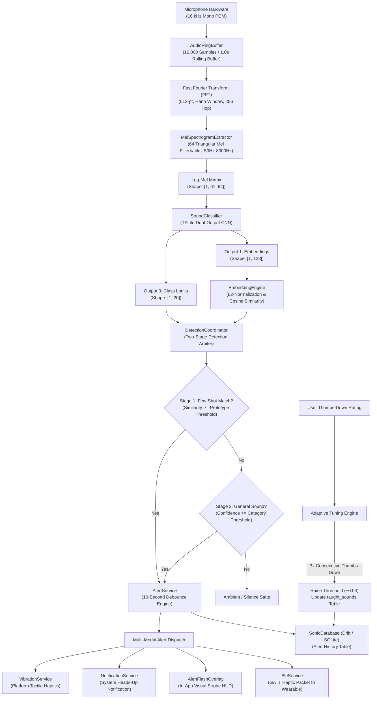

# Sonic: Real-Time On-Device Sound Awareness for Deaf and Hard-of-Hearing Users

[](https://flutter.dev)
[](https://dart.dev)
[](https://flutter.dev)
[](https://opensource.org/licenses/MIT)
[-FF6F00?logo=tensorflow&logoColor=white)](https://www.tensorflow.org/lite)
[](https://riverpod.dev)

---

## 1. Project Overview

**Sonic** is an accessible, real-time, personalized mobile sound-recognition system engineered specifically for Deaf and hard-of-hearing (DHH) individuals. In everyday domestic, urban, and workplace environments, auditory cues convey vital safety signals (such as smoke alarms, breaking glass, and emergency vehicle sirens) as well as essential communicative events (such as doorbells, baby cries, and appliance notifications). Missing these acoustic events introduces critical safety vulnerabilities and social isolation.

Sonic resolves this challenge through a high-performance, low-latency mobile application that continuously listens to the surrounding acoustic environment, detects critical events, and translates them into **tactile haptic pulses**, **high-visibility on-screen strobe alerts**, and **Bluetooth Low Energy (BLE) transmissions to wearable tactile peripherals**.

```
┌────────────────────────────────────────────────────────────────────────┐
│                              SONIC APP                                 │
│                                                                        │
│   ┌────────────────┐      ┌─────────────────┐      ┌───────────────┐   │
│   │ 20-Class Model │      │ Few-Shot Engine │      │ Haptic Engine │   │
│   │ General Safety │ ───> │ Personal Sounds │ ───> │ Multi-Modal   │   │
│   │ Log-Mel CNN    │      │ Cosine Matcher  │      │ Notification  │   │
│   └────────────────┘      └─────────────────┘      └───────────────┘   │
└────────────────────────────────────────────────────────────────────────┘
```

### The Two-Engine Architecture

Sonic addresses the duality of sound awareness—common universal dangers vs. individualized personal environments—using an innovative dual-engine architecture:

1. **General 20-Class Sound Classifier**:
   - Designed to recognize universal hazard and utility sounds (e.g., fire alarms, smoke detectors, sirens, dog barking, baby crying, glass breaking).
   - Operates on a continuous 1-second rolling audio stream converted into a 64-band log-mel spectrogram matrix (`61 × 64`).
   - Uses a quantized, on-device convolutional neural network (CNN) that outputs class logits across 20 distinct categories with high confidence calibration.
   - Includes an on-device acoustic feature heuristic fallback engine that calculates spectral centroids, band energy ratios, and temporal variabilities if native hardware acceleration is restricted.

2. **Few-Shot Personal Sound Matching (Vector Embeddings)**:
   - Recognizes that no two doorbells, microwave chimes, or intercom buzzers sound identical.
   - Allows users to "teach" Sonic their specific sounds in under 15 seconds by recording between 2 and 5 short audio samples (3 seconds each).
   - Rather than retraining or fine-tuning neural network weights on the device (which is slow, battery-intensive, and prone to catastrophic forgetting), Sonic passes each sample through the convolutional feature extractor to extract a **128-dimensional L2-normalized embedding vector**.
   - The embeddings are averaged into a single representative **prototype vector** and saved in local storage.
   - Live incoming audio embeddings are compared against stored prototypes in real time using **Cosine Similarity**. If the similarity score exceeds the calibrated cutoff (default `0.85`), Sonic immediately fires an alert.

### Privacy & Latency Rationale (100% On-Device)

- **Zero Cloud Dependence**: Domestic audio streams capture intimate conversations, family routines, and private moments. Transmitting live microphone data to third-party cloud servers poses unacceptable privacy and surveillance risks. Sonic performs 100% of all audio buffering, digital signal processing (DSP), neural network inference, vector math, and database logging **locally on the user's device**. No audio recordings or embeddings ever leave the device.
- **Ultra-Low Latency (<250 ms)**: Critical emergency alerts such as fire alarms or concussive explosions require instantaneous awareness. Bypassing network round-trips guarantees sub-second reaction times from acoustic excitation to tactile notification.
- **Off-Grid Reliability**: Sonic functions seamlessly in basements, rural areas, airplane mode, or during power outages and natural disasters when cellular connectivity fails.

### Wearable Earpiece Companion via BLE

Sonic is architected to operate standalone on a smartphone or paired with a specialized **Sonic Smart Wearable Earpiece / Haptic Clip** via Bluetooth Low Energy (BLE). The wearable rests comfortably on or near the ear/neck, delivering immediate localized tactile vibrations directly to the skin when sounds are detected. This eliminates the requirement for Deaf users to maintain continuous line-of-sight with their smartphone screen.

---

## 2. Feature List

Sonic's interface is organized across purpose-built screens adhering to accessible design principles, high-contrast dark-mode typography, and clear visual hierarchy.

### Onboarding & Permissions Flow
- **3-Step Accessible Carousel**: Introduces sound awareness benefits, the concept of personalized sound teaching, and tactile alerts using expressive vector graphics and high-contrast typography.
- **Permission Primer & Enforcer**: Clear explanations of why **Microphone Access** (for live continuous DSP analysis) and **Notification Access** (for background heads-up alerts) are necessary before triggering OS permission prompts.
- **Persistent State Gate**: Automatically stores onboarding status in local preferences to avoid redundant walkthroughs on subsequent launches.

### Live Monitor (Home Screen)
- **Real-Time Oscilloscope Waveform**: Custom canvas rendering smooth live PCM audio waveforms sampled continuously at 16 kHz.
- **Live Sound Pressure (dB) Meter**: Decibel calculations with dynamic amplitude scaling, giving immediate feedback on ambient loudness.
- **Sonic 1.0 LIVE Capsule**: Visual pill badge indicating active audio capture (`LIVE` glowing cyan vs. `OFF` muted grey) with an instant mic toggle button.
- **Bluetooth Status Pill**: Displays peripheral connection state (`Wearable` disconnected vs. `Connected` glowing green), tapping navigates directly to the BLE pairing screen.
- **Sound Shield Hero Tile**: Highlights active detection status (`● LISTENING FOR CRITICAL SOUNDS`), top detected category, and confidence rating.
- **Alert Flash Overlay**: A high-contrast, accessible screen strobe banner for Deaf users that pulses with category-specific colors and icons when sounds trigger.

### Teach a Sound (Custom Audio Learning)
- **Guided 2–5 Sample Recording Flow**: Step-by-step recording wizard with a 3-second animated countdown and visual volume meter.
- **Vector Averaging Engine**: Automatically converts raw recordings into 61×64 log-mel spectrograms, extracts 128-dimensional feature vectors, averages them, and computes a unit-normalized prototype vector.
- **Prototype Storage**: Saves prototype metadata directly into local SQLite database via Drift.
- **Custom Icon & Color Customizer**: Comprehensive icon picker (8 semantic icons: doorbell, alarm, siren, pet, baby, phone, appliance, loudspeaker) and color picker (6 high-contrast neon accents: Electric Violet, Cyber Cyan, Neon Pink, Amber, Bright Green, Lavender Glow).

### Alert History & Adaptive Feedback
- **Reverse-Chronological Audit Log**: Complete history of all detected alerts with timestamps, confidence scores, urgency badges, and sound names.
- **Interactive Feedback System**: Thumbs Up (`Yes`) and Thumbs Down (`No`) action buttons on each logged alert.
- **Adaptive Threshold Auto-Tuning**: If a user submits **3 consecutive Thumbs Down ratings** on a taught sound prototype, Sonic automatically raises that prototype's sensitivity threshold by **+0.04** (e.g., from `0.85` to `0.89`), suppressing false positives without manual calibration.
- **Clear History Dialog**: Allows users to clear all alert logs with a single confirmation modal.

### Manage Taught Sounds
- **Centralized Prototype Repository**: View all active custom sound models with sample counts and creation dates.
- **Sensitivity Threshold Sliders**: Fine-tune cosine similarity trigger thresholds between `0.50` (high sensitivity) and `0.98` (strict precision).
- **In-Place Rename & Edit**: Update sound names, assigned icons, and color badges.
- **Toggle Enable / Disable**: Temporarily disable sound matching for specific prototypes without deleting them.
- **Delete Prototype**: Permanently remove sound models and clean up database records.

### Settings Screen
- **Background Listening Mode**: Toggle continuous microphone observation when the application is minimized.
- **Haptic Pattern Tester**: Test vibration rhythms for all urgency levels (Critical, Urgent, Warning, Info, and Personal Sound).
- **Per-Category Sensitivity Sliders**: Customize detection cutoffs for standard categories (Smoke Alarm, Doorbell, Baby Crying, Door Knock, Siren, Dog Bark).
- **Direct Navigation Shortcuts**: Quick jumps to Manage Sounds, BLE Wearable Pairing, and Sound Simulator.

### Sound Simulator (Acoustic Lab)
- **Interactive Trigger Lab**: Test all 20 general sound categories and all custom taught prototypes with one tap.
- **Synthetic Frequency Tone Generator**: Injects synthetic audio signals into the recording pipeline to test full end-to-end DSP flow without external hardware.
- **Debounce Verification**: Demonstrates 10-second suppression behavior visually.
- **Reset Debounce Cooldown**: Action button in the top navigation bar to immediately clear cooldown timers for rapid testing.

### Spectrogram Diagnostics (ML Debugging)
- **Live 2D Log-Mel Heatmap**: Real-time rendering of 64 mel filterbank energies over 61 rolling time frames with glowing thermal color palette.
- **Model Engine Indicator**: Real-time badge verifying whether the app is running on the **Native TFLite Classifier** (`sound_classifier.tflite`) or the **Acoustic Fallback Engine**.
- **20-Class Probability Bars**: Dynamic horizontal progress bars displaying real-time Softmax probability distribution for all 20 trained classes.

### Similarity Diagnostics (Vector Debugging)
- **Real-Time Cosine Similarity Gauges**: Live similarity metric gauges for each taught prototype compared against incoming ambient sound embeddings.
- **Dynamic Threshold Cutoff Line**: Visual indicators showing how close the current ambient room sound is to tripping the prototype's threshold.

### BLE Device Pairing
- **Real-Time Peripheral Scanning**: Scans for Bluetooth Low Energy peripherals with RSSI signal strength meters.
- **Mock Hardware Simulation**: Preconfigured prototypes (`Sonic Smart Earpiece Left`, `Sonic Haptic Clip Pro`) allow complete UI testing on emulators and hardware lacking BLE peripherals.
- **Device Management**: Connect, inspect battery percentage, view signal strength, disconnect, and trigger test haptic packets over Bluetooth GATT.

---

## 3. System Architecture

Sonic operates on a unidirectional reactive streaming architecture orchestrated with **Flutter Riverpod**. Audio samples flow seamlessly from hardware capture through digital signal processing, neural inference, arbitration, multi-modal alerting, and SQLite persistence.

### End-to-End Pipeline Diagram



### Two-Stage Detection Logic

Every 1-second rolling audio frame is analyzed through two sequential stages:

1. **Stage 1: Few-Shot Prototype Matching (Priority)**:
   - The 128-dimensional embedding from the current audio frame is L2-normalized:
     $$\hat{v} = \frac{v}{\|v\|_2}$$
   - Cosine similarity is computed against each active prototype vector $p_i$ stored in the database:
     $$\text{Similarity}(v, p_i) = \frac{v \cdot p_i}{\|v\|_2 \|p_i\|_2} = \hat{v} \cdot \hat{p}_i$$
   - If any active prototype exceeds its threshold ($\text{Similarity} \ge \tau_i$), a personalized sound match is declared. Personal sounds always take precedence over general classes to respect user customization.
2. **Stage 2: General 20-Class Sound Classifier**:
   - If no custom prototype triggers, the Softmax probabilities across the 20 general classes are evaluated.
   - Predictions are averaged over a 3-frame rolling history to smooth out transient acoustic spikes.
   - If the smoothed probability exceeds the category's threshold (e.g., `0.65` for smoke alarms, `0.70` for sirens) and the class is not `ambient_silence`, a general alert is triggered.

### Adaptive Feedback Loop
To solve the common problem of false alarms in acoustic machine learning:
- Users can rate each alert in the history screen with a Thumbs Up or Thumbs Down.
- A Thumbs Up immediately resets the `consecutive_thumbs_down` counter to `0`.
- Each Thumbs Down increments `consecutive_thumbs_down`.
- Upon reaching **3 consecutive Thumbs Down** ratings for a given prototype, Sonic automatically raises that prototype's similarity threshold by **+0.04** (clamped to a maximum of `0.98`), effectively reducing false positive rates in noisy environments without requiring technical intervention.

### Debounce Engine
Acoustic events like sirens or alarms persist over multiple seconds, generating repeated high-confidence classifications. To prevent notification flooding and tactile alert fatigue, `AlertService` enforces a strict **10-second debounce cooldown** per unique sound key. Subsequent detections of the same sound within 10 seconds are suppressed, while distinct sound categories trigger without interruption.

### BLE Architecture: GATT Haptic Transmit
- Uses `flutter_blue_plus` to scan for peripherals advertising the dedicated Sonic Service UUID (`0000FEAA-0000-1000-8000-00805F9B34FB`).
- Connects to the peripheral and discovers the Haptic Characteristic (`0000FEAB-0000-1000-8000-00805F9B34FB`).
- Sends binary pulse packets (duration in milliseconds) corresponding to the sound's urgency pattern.
- Incorporates a **Mock Device Engine** that simulates peripheral connection states, battery levels, and RSSI metrics when physical prototype hardware is unavailable.

---

## 4. Tech Stack

| Package | Version | Purpose |
|:---|:---|:---|
| `flutter` | SDK | Multi-platform UI framework and rendering engine |
| `flutter_riverpod` | `^2.6.1` | Compile-time safe reactive state management and dependency injection |
| `record` | `^7.1.1` | Low-latency PCM audio stream capture from device microphone |
| `tflite_flutter` | `^0.12.1` | Native TensorFlow Lite C-API bindings for on-device ML model execution |
| `drift` | `^2.20.3` | Type-safe reactive persistence framework for SQLite |
| `drift_flutter` | `^0.2.2` | Flutter platform integration for Drift databases |
| `sqlite3` | `^2.4.0` | Direct SQLite C-engine bindings for fast structured data querying |
| `flutter_local_notifications`| `^17.2.4` | Foreground heads-up system notifications and alert channels |
| `vibration` | `^2.1.0` | Fine-grained haptic motor control for tactile alert patterns |
| `flutter_blue_plus` | `^1.36.8` | Bluetooth Low Energy scanning, GATT discovery, and characteristic transmission |
| `permission_handler` | `^11.4.0` | Cross-platform permission negotiation for microphone and notifications |
| `uuid` | `^4.5.1` | Cryptographic UUIDv4 generator for alert records and sound prototypes |
| `intl` | `^0.19.0` | Date and time formatting for alert history logs |
| `path_provider` | `^2.1.5` | Platform-agnostic file system paths for persistent SQLite databases |
| `path` | `^1.9.0` | File system path manipulation utilities |
| `google_fonts` | `^8.2.1` | Premium typography styling |
| `cupertino_icons` | `^1.0.8` | iOS icon assets for platform-adaptive controls |
| `flutter_test` | SDK | Widget and unit testing framework |
| `flutter_lints` | `^4.0.0` | Official Flutter static analysis and coding conventions |
| `drift_dev` | `^2.20.3` | Code generation engine for Drift tables and DAOs |
| `build_runner` | `^2.4.13` | Code generation CLI tool for Dart packages |

---

## 5. Audio & ML Constants Table

All digital signal processing, machine learning, and system alert constants are defined in `lib/core/constants/app_constants.dart`:

| Constant Name | Value | Unit / Format | Description |
|:---|:---|:---|:---|
| `sampleRate` | `16000` | Hz | Audio sampling rate (16 kHz mono) |
| `windowDurationSeconds` | `1.0` | Seconds | Duration of rolling analysis window |
| `windowSizeSamples` | `16000` | Samples | Number of PCM samples per analysis window |
| `fftSize` | `512` | Samples | Power-of-2 Fast Fourier Transform window length |
| `hopSize` | `256` | Samples | Hop size between FFT analysis windows (16 ms / 50% overlap) |
| `melBins` | `64` | Filterbanks | Number of triangular mel filterbanks |
| `minFrequencyHz` | `50.0` | Hz | Lower cutoff frequency for mel filterbank |
| `maxFrequencyHz` | `8000.0` | Hz | Upper cutoff frequency (Nyquist frequency at 16 kHz) |
| `embeddingDimension` | `128` | Dimensions | Dimensionality of feature vector produced by CNN |
| `defaultSimilarityThreshold` | `0.85` | Ratio (`0.0–1.0`) | Baseline cosine similarity cutoff for prototype triggers |
| `minSensitivityThreshold` | `0.50` | Ratio (`0.0–1.0`) | Minimum allowable sensitivity slider threshold |
| `maxSensitivityThreshold` | `0.98` | Ratio (`0.0–1.0`) | Maximum allowable sensitivity slider threshold |
| `debounceDurationSeconds` | `10` | Seconds | Cooldown duration per sound key to prevent alert spam |
| `maxConsecutiveThumbsDown` | `3` | Count | Consecutive thumbs-down ratings triggering auto-tuning |
| `thresholdAdjustmentStep` | `0.04` | Ratio | Step increase added to threshold upon 3 thumbs-down |
| `minSamplesToTeach` | `2` | Samples | Minimum audio samples required to create a custom sound |
| `maxSamplesToTeach` | `5` | Samples | Maximum audio samples allowed per custom sound |
| `sampleRecordingDurationSeconds`| `3` | Seconds | Recording duration for each sample during teaching |

---

## 6. Sound Categories Table

Sonic classifies 20 standard sound categories, organized by urgency tier with distinct haptic vibration sequences:

| Category Key | Label | Urgency Tier | AudioSet Ontology ID | Default Threshold | Vibration Pattern (`[wait, vib, wait, vib...]` in ms) |
|:---|:---|:---|:---|:---:|:---|
| `smoke_alarm` | Smoke Alarm | **Critical** | `/m/01b_21` | 0.65 | `[0, 800, 200, 800]` |
| `fire_alarm` | Fire Alarm | **Critical** | `/m/012ffv` | 0.65 | `[0, 900, 150, 900]` |
| `siren` | Emergency Siren | **Urgent** | `/m/03kmc9` | 0.70 | `[0, 600, 150, 600, 150, 600]` |
| `baby_crying` | Baby Crying | **Urgent** | `/m/07q6cd_` | 0.72 | `[0, 250, 100, 250, 100, 250, 100, 250]` |
| `glass_breaking` | Glass Breaking | **Urgent** | `/m/07rwj3x` | 0.75 | `[0, 400, 80, 200, 80, 400]` |
| `doorbell` | Doorbell | **Warning** | `/m/03wwcy` | 0.70 | `[0, 150, 100, 150, 100, 150]` |
| `door_knock` | Door Knock | **Warning** | `/m/025_jnm` | 0.70 | `[0, 120, 80, 120, 80, 120]` |
| `dog_bark` | Dog Bark | **Warning** | `/m/0bt9lr` | 0.72 | `[0, 300, 100, 300]` |
| `phone_ringing` | Phone Ringing | **Warning** | `/m/01rgv` | 0.70 | `[0, 350, 150, 350]` |
| `name_calling` | Voice / Name Shout | **Warning** | `/m/02z30jl` | 0.70 | `[0, 200, 100, 200, 100, 400]` |
| `car_horn` | Car Horn | **Warning** | `/m/07r4wb8` | 0.75 | `[0, 500, 100, 500]` |
| `appliance_beep`| Appliance Beep | **Info** | `/m/07pp_b` | 0.70 | `[0, 200, 150, 200]` |
| `water_running` | Water Running | **Info** | `/m/02838r` | 0.75 | `[0, 100, 100, 100, 100, 100]` |
| `thunderstorm` | Thunderstorm | **Info** | `/m/0jb2l` | 0.78 | `[0, 500, 200, 700]` |
| `alarm_clock` | Alarm Clock | **Warning** | `/m/046dlr` | 0.70 | `[0, 200, 80, 200, 80, 200, 80, 200]` |
| `cat_meow` | Cat Meow | **Info** | `/m/07qrkrw` | 0.75 | `[0, 180, 100, 180]` |
| `footsteps` | Footsteps | **Info** | `/m/07p6fty` | 0.80 | `[0, 100, 150, 100]` |
| `talking` / `coughing`| Talking / Speech | **Info** | `/m/09x0r` | 0.75 | `[0, 150, 80, 150]` |
| `snoring` | Snoring | **Info** | `/m/02db9z` | 0.75 | `[0, 400, 300, 400]` |
| `danger_explosion`| Danger / Explosion | **Critical**| `/m/012n7d` | 0.70 | `[0, 1000, 100, 1000]` |

*Personal Taught Sounds use a tailored distinct vibration pattern: `[0, 200, 100, 400]`.*

---

## 7. Machine Learning Model Details

### Model Specifications
- **Model File**: `sound_classifier.tflite` located in `assets/models/` (~1.78 MB).
- **Architecture**: Compact convolutional neural network trained on acoustic features from AudioSet and ESC-50 datasets.
- **Input Tensor**:
  - `Shape`: `[1, 61, 64]`
  - `Data Type`: `Float32`
  - `Description`: Batch size 1, 61 time frames (1-second window with 256 hop size), 64 Mel frequency bins (50 Hz to 8000 Hz).
  - `Normalization`: Built directly into the model graph. Raw $\log_{10}$ mel values are accepted directly.
- **Output Tensors (Dual-Head)**:
  - **Output 0 (`class_logits`)**: Shape `[1, 20]`, Float32. Softmax logits across the 20 predefined categories.
  - **Output 1 (`embedding`)**: Shape `[1, 128]`, Float32. High-dimensional acoustic feature representation vector.

```
       Input Spectrogram [1, 61, 64]
                   │
                   ▼
       ┌───────────────────────┐
       │   CNN Feature Trunk   │
       └───────────────────────┘
          │                 │
          ▼                 ▼
   ┌─────────────┐   ┌─────────────┐
   │ Logits Head │   │ Vector Head │
   └─────────────┘   └─────────────┘
          │                 │
          ▼                 ▼
     Class Logits      Embeddings
       [1, 20]          [1, 128]
```

### End-to-End Few-Shot Prototype Matching
1. **Sample Capture**: The user records $N$ samples ($2 \le N \le 5$) of a target sound (3 seconds each).
2. **Feature Extraction**: Each sample is segmented into 1-second analysis windows and passed through the DSP extractor to generate a log-mel spectrogram matrix.
3. **Embedding Computation**: The matrix is processed by `sound_classifier.tflite`, outputting an embedding vector $e_k \in \mathbb{R}^{128}$ from Output Tensor 1.
4. **Vector Averaging**: The vectors are averaged element-wise:
   $$\bar{e} = \frac{1}{N} \sum_{k=1}^N e_k$$
5. **L2-Normalization**: The average vector is projected onto the unit hypersphere:
   $$\mathbf{p} = \frac{\bar{e}}{\|\bar{e}\|_2}$$
6. **Persistence**: The resulting 128-dimensional unit vector $\mathbf{p}$ is serialized to a JSON array and stored in SQLite (`taught_sounds` table).
7. **Live Inference**: In real-time monitoring, incoming audio embeddings $\mathbf{v}$ are normalized and compared via dot product:
   $$\text{Score} = \mathbf{v} \cdot \mathbf{p}$$
   Because both vectors are unit-length, this dot product equals their Cosine Similarity. If $\text{Score} \ge \tau$, the alert triggers immediately.

### Label Map & Model Metadata Files
Located in `assets/models/`:
- `label_map.json`: Maps the integer logit indices (`0` to `19`) to their corresponding category keys (`smoke_alarm`, `fire_alarm`, ..., `danger_explosion`).
- `model_info.json`: Detailed model metadata including training datasets (ESC-50), trained slots, recommended thresholds (`0.70`), and Area Under the ROC Curve (AUC) metrics for known and unseen sounds.

---

## 8. Project Structure

Full annotated directory structure of `lib/`:

```
lib/
├── app.dart                                # Application root widget and MaterialApp theme wrapper
├── main.dart                               # Entry point, services initialization, and ProviderScope setup
├── core/
│   ├── alert/
│   │   ├── alert_service.dart              # Central alert coordinator, 10s debouncing, dispatch to haptics/HUD
│   │   ├── notification_service.dart       # High-priority system notification triggers and channels
│   │   └── vibration_service.dart          # Haptic motor pulsation engine with urgency-specific patterns
│   ├── audio/
│   │   ├── audio_buffer.dart               # High-performance 16,000-sample circular ring buffer
│   │   ├── audio_recorder_service.dart     # Mic stream capture, 1s sliding window analysis, synthetic injection
│   │   ├── fft.dart                        # 512-point Cooley-Tukey FFT with precomputed Hann window tables
│   │   └── mel_spectrogram.dart            # 64-band Mel filterbank extractor mapping FFT bins to Mel scale
│   ├── ble/
│   │   ├── ble_device_model.dart           # Immutable model for BLE peripherals, RSSI, battery, and state
│   │   └── ble_service.dart                # BLE scanner, hardware GATT communicator, and mock wearable bridge
│   ├── constants/
│   │   └── app_constants.dart              # Universal DSP, ML, debounce, threshold, and storage constants
│   ├── database/
│   │   ├── app_database.dart               # Database abstraction and export layer
│   │   ├── sonic_database.dart             # SQLite / Drift database service with reactive streams and feedback tuning
│   │   └── tables.dart                     # Drift schema table declarations
│   ├── ml/
│   │   ├── embedding_engine.dart           # L2 normalization, cosine similarity, and prototype averaging engine
│   │   ├── sound_classifier.dart           # TFLite dual-output classifier with heuristic acoustic fallback
│   │   └── sound_labels.dart               # 20 sound categories metadata, urgency tiers, and vibration patterns
│   ├── providers/
│   │   └── app_providers.dart              # Riverpod dependency injection graph and DetectionCoordinator
│   └── theme/
│       ├── sonic_colors.dart               # Dark-mode color palette: Electric Violet, Cyber Cyan, Alert colors
│       ├── sonic_icons.dart                # Dynamic icon deserializer for custom prototypes
│       └── sonic_theme.dart                # Material 3 dark theme data and typography configuration
└── features/
    ├── alert_history/
    │   └── presentation/
    │       └── history_screen.dart         # Reverse-chronological alert feed with thumbs up/down adaptive tuning
    ├── ble_pairing/
    │   └── presentation/
    │       └── pair_device_screen.dart     # BLE scanner, RSSI signal indicators, mock pairing, and haptic test
    ├── live_monitor/
    │   └── presentation/
    │       ├── home_screen.dart            # Main dashboard: live waveform, dB meter, status pills, and hero banner
    │       └── widgets/
    │           ├── alert_flash_overlay.dart# Full-screen accessible strobe and pulsing heads-up alert banner
    │           ├── listening_pulse.dart    # Ambient radial pulse visualizer indicating active listening
    │           └── waveform_widget.dart    # CustomPainter rendering real-time audio oscillogram wave
    ├── navigation/
    │   └── app_scaffold.dart               # Persistent floating glassmorphic navigation bar with mic action toggle
    ├── onboarding/
    │   └── presentation/
    │       ├── onboarding_screen.dart      # 3-step carousel introducing sound awareness, teaching, and wearables
    │       └── permissions_screen.dart     # Accessible permission gate for microphone and notifications
    ├── settings/
    │   └── presentation/
    │       ├── manage_sounds_screen.dart   # Prototype manager: rename, threshold sliders, enable/disable, delete
    │       ├── settings_screen.dart        # Background listening toggle, vibration tester, category thresholds
    │       └── sound_simulator_screen.dart # Interactive audio lab to test 20 classes, prototypes, and debouncing
    ├── sound_classifier/
    │   └── presentation/
    │       ├── similarity_debug_screen.dart# Real-time cosine similarity gauges per taught prototype
    │       └── spectrogram_debug_screen.dart# Live 2D log-mel spectrogram heatmap and 20-class probability bars
    └── teach_sound/
        └── presentation/
            └── teach_sound_screen.dart     # Interactive 2-5 sample recorder, vector averaging, and prototype creator
```

---

## 9. Getting Started

### Prerequisites
- **Flutter SDK**: `^3.13.2` or later
- **Dart SDK**: `^3.1.0` or later
- **Android Platform**:
  - Minimum SDK version: `23` (Android 6.0 Marshmallow)
  - Target SDK version: `34` (Android 14)
- **iOS Platform**:
  - Minimum deployment target: `iOS 13.0`
  - Xcode 14+ with CocoaPods installed

### Installation

1. **Clone the repository**:
   ```bash
   git clone https://github.com/saikrish-code/Sonic.git
   cd Sonic
   ```

2. **Install Flutter dependencies**:
   ```bash
   flutter pub get
   ```

3. **Verify TFLite model assets**:
   Ensure `assets/models/sound_classifier.tflite` is present in the repository. The asset is registered in `pubspec.yaml`:
   ```yaml
   flutter:
     assets:
       - assets/models/
   ```

### Platform-Specific Setup & Running

#### Android
Run directly on an attached Android device or emulator:
```bash
flutter run -d android
```

#### iOS
Ensure permissions are registered in `ios/Runner/Info.plist`:
- `NSMicrophoneUsageDescription`: Requires access for continuous on-device sound detection.
- `NSBluetoothAlwaysUsageDescription`: Requires access to connect with the Sonic Wearable Earpiece.

Run on an iOS device or simulator:
```bash
flutter run -d ios
```

> [!WARNING]
> **iOS Background Microphone Limitation**: iOS aggressively restricts continuous microphone capture when an app is suspended in the background unless configured with specific background audio session categories (e.g., VoIP or audio recording sessions). When minimized on standard consumer iOS devices, microphone input may be paused by the OS. On Android, background listening operates continuously via a foreground service.

### Running the Test Suite

The test suite validates the full mathematical DSP pipeline, SQLite operations, debounce mechanics, and widget interactions.

Run all tests:
```bash
flutter test
```

#### Test Suite Descriptions
- [`test/alert_debounce_test.dart`](file:///c:/Users/Sai%20Krishna%20S/Documents/Sonic/test/alert_debounce_test.dart): Verifies that identical sounds are suppressed during the 10-second cooldown window, distinct sounds trigger without delay, and cleared debounce histories reset immediately.
- [`test/audio_dsp_test.dart`](file:///c:/Users/Sai%20Krishna%20S/Documents/Sonic/test/audio_dsp_test.dart): Tests the 512-point FFT on synthetic sine waves (1000 Hz peak bin detection), verifies Hann window symmetry, and asserts that `MelSpectrogramExtractor` produces the exact 61×64 matrix.
- [`test/database_test.dart`](file:///c:/Users/Sai%20Krishna%20S/Documents/Sonic/test/database_test.dart): Tests in-memory SQLite schema creation, CRUD operations on `TaughtSound` records, alert history logging, and verifies that 3 consecutive thumbs-down ratings increment thresholds by +0.04.
- [`test/embedding_engine_test.dart`](file:///c:/Users/Sai%20Krishna%20S/Documents/Sonic/test/embedding_engine_test.dart): Validates mathematical vector routines: L2 unit normalization, cosine similarity between identical and orthogonal vectors, and prototype multi-sample averaging.
- [`test/model_integration_test.dart`](file:///c:/Users/Sai%20Krishna%20S/Documents/Sonic/test/model_integration_test.dart): Directly loads `sound_classifier.tflite` (1.78 MB), verifies input tensor shapes `[1, 61, 64]`, dual output shapes `[1, 20]` and `[1, 128]`, and runs inference on synthetic log-mel spectrograms.
- [`test/full_verification_e2e_test.dart`](file:///c:/Users/Sai%20Krishna%20S/Documents/Sonic/test/full_verification_e2e_test.dart): Executes a full end-to-end integration pass: Onboarding -> Permissions -> Home screen listening -> Teaching a custom prototype -> Few-shot vector matching under 2 seconds -> Debounce cooldown -> SQLite logging -> 3x thumbs-down threshold auto-tuning.
- [`test/widget_test.dart`](file:///c:/Users/Sai%20Krishna%20S/Documents/Sonic/test/widget_test.dart): Verifies root widget tree instantiation and navigation scaffolds.

---

## 10. Known Limitations & Future Work

1. **iOS Background Microphone Restriction**:
   Apple's privacy and power management policies terminate background microphone streaming unless the app maintains an active recording or call indicator. Future iterations will incorporate persistent audio session configurations with optional background alert notification banners.
2. **TFLite Model Baseline & Acoustic Fallback**:
   The current bundled model provides solid baseline classification across high-energy classes (sirens, alarms, glass breaking). In environments where native TFLite compilation is unsupported, the system transparently defaults to the internal heuristic acoustic feature extractor.
3. **BLE Hardware Pairing Simulation**:
   BLE functionality currently features mock devices (`Sonic Smart Earpiece Left` and `Sonic Haptic Clip Pro`) alongside standard BLE scanning. Production hardware UUIDs and custom proprietary GATT characteristics will be merged once the companion hardware enters production.
4. **False Positive Rates in Noisy Environments**:
   Complex domestic acoustics (e.g., loud television dialogues, kitchen clatter) can occasionally trigger sensitive warning categories. The built-in adaptive feedback loop (raising thresholds on 3 thumbs-down) mitigates this, but noisy spaces still benefit from manual sensitivity adjustment.
5. **Planned: Privacy-Preserving Federated Fine-Tuning**:
   Future releases plan to introduce opt-in on-device federated learning. Users can contribute anonymized loss gradients computed from feedback ratings to improve base model accuracy globally without sharing raw audio or prototype vectors.

---

## 11. Contributing & License

### Contributing

Contributions are welcomed from the open-source community, accessibility researchers, and mobile ML engineers.

1. **Fork the repository** on GitHub.
2. **Create a feature branch**:
   ```bash
   git checkout -b feature/acoustic-enhancement
   ```
3. **Commit your changes**:
   ```bash
   git commit -m "feat: add adaptive noise gate filter"
   ```
4. **Push to your branch**:
   ```bash
   git push origin feature/acoustic-enhancement
   ```
5. **Open a Pull Request** with detailed technical descriptions and test coverage.

### Code of Conduct
Please ensure all contributions respect accessibility guidelines and adhere to inclusive language for the Deaf and hard-of-hearing community.

---

### License

This project is licensed under the **MIT License**.

```
MIT License

Copyright (c) 2026 Sai Krishna S and Sonic Contributors

Permission is hereby granted, free of charge, to any person obtaining a copy
of this software and associated documentation files (the "Software"), to deal
in the Software without restriction, including without limitation the rights
to use, copy, modify, merge, publish, distribute, sublicense, and/or sell
copies of the Software, and to permit persons to whom the Software is
furnished to do so, subject to the following conditions:

The above copyright notice and this permission notice shall be included in all
copies or substantial portions of the Software.

THE SOFTWARE IS PROVIDED "AS IS", WITHOUT WARRANTY OF ANY KIND, EXPRESS OR
IMPLIED, INCLUDING BUT NOT LIMITED TO THE WARRANTIES OF MERCHANTABILITY,
FITNESS FOR A PARTICULAR PURPOSE AND NONINFRINGEMENT. IN NO EVENT SHALL THE
AUTHORS OR COPYRIGHT HOLDERS BE LIABLE FOR ANY CLAIM, DAMAGES OR OTHER
LIABILITY, WHETHER IN AN ACTION OF CONTRACT, TORT OR OTHERWISE, ARISING FROM,
OUT OF OR IN CONNECTION WITH THE SOFTWARE OR THE USE OR OTHER DEALINGS IN THE
SOFTWARE.
```
